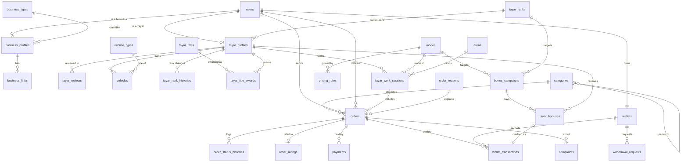

# Tayari · Database design

Nov 15, 2026 · @Amgad

## Overview and main decisions

This is the MySQL 8 schema for the Tayari Laravel backend (Sanctum, Spatie Permission, Spatie Media Library, Spatie Translatable). It covers sign up for businesses, customers and Tayars, categories, vehicles, modes, orders, payments, wallets and complaints.

- **One `users` table for everyone.** Everyone signs up with name, phone and password. What a person can do comes from their profile: `account_type` (individual or business) for sending, and a `tayar_profiles` row for driving. One phone can later be both a business and a Tayar without a second account.
- **Receivers don't need an account.** An order stores the receiver's phone. If the receiver later signs up with that phone, `orders.receiver_user_id` links them so they can follow the order in the app.
- **Money is a ledger, not just a balance.** Every money move is a row in `wallet_transactions`. `wallets.balance` is only a cached total, updated in the same database transaction. This makes disputes and the daily 11 pm withdrawal rule easy to check.
- **No cash with the Tayar.** In this flow the receiver pays before delivery (Instapay, mobile wallet or card), so the Tayar never carries cash. If cash on delivery comes back later, add cash tracking per Tayar.
- **Lists the admin edits** (categories, business types, vehicle types, modes, reasons) store their names as JSON `{"ar": "…", "en": "…"}` with Spatie Translatable.
- **No file path columns.** All photos and documents go through Spatie Media Library collections on each model. Personal documents (ID, criminal record, licences) go on a private disk.
- **Types:** money is `decimal(10,2)` in EGP, coordinates are `decimal(10,7)`, and status columns are string enums backed by PHP enums.
- **Holding money:** Tayari holds the receiver's payment until delivery. Before launch, check with your payment provider (or a lawyer) what's needed in Egypt to hold money on behalf of others.

## How the tables connect

The package tables (`personal_access_tokens`, the Spatie roles and permissions tables, and `media`) aren't drawn. They connect to `users` and to every model that has files.

## Accounts and profiles

### users

Everyone: customers, businesses, Tayars and admins. Sign up asks only for name, phone, password and password confirmation; the rest comes after.

| Column | Type | Notes |
| --- | --- | --- |
| id | bigint |  |
| name | string |  |
| phone | string, unique | Stored as +20… |
| phone\_verified\_at | timestamp, null | Set after the OTP is confirmed |
| secondary\_phone | string, null | The "second number if available" |
| email | string, null, unique | Optional |
| password | string | Hashed |
| account\_type | enum: individual, business | Sender side; individual by default |
| locale | enum: ar, en | Default ar; used for SMS, WhatsApp and push |
| last\_mode | enum: client, tayar | The app reopens in this mode |
| status | enum: active, blocked |  |
| blocked\_reason | string, null |  |
| remember\_token, timestamps, deleted\_at |  | Soft delete |

Admins and ops staff are normal users with Spatie roles (admin, ops, support).

### otp\_codes

Phone verification and password reset.

| Column | Type | Notes |
| --- | --- | --- |
| id | bigint |  |
| phone | string, index |  |
| purpose | enum: verify\_phone, reset\_password |  |
| code\_hash | string | Never store the plain code |
| attempts | tinyint | Block after a few wrong tries |
| expires\_at | timestamp | About 5 minutes |
| used\_at | timestamp, null |  |
| created\_at | timestamp |  |

### user\_devices

Push notification tokens, one row per phone or browser.

| Column | Type | Notes |
| --- | --- | --- |
| id | bigint |  |
| user\_id | FK users |  |
| platform | enum: android, ios, web |  |
| push\_token | string, unique | FCM token |
| last\_seen\_at | timestamp, null |  |

### business\_types

The list of business types the app shows.

| Column | Type | Notes |
| --- | --- | --- |
| id | bigint |  |
| name | json | Translatable |
| is\_active | boolean |  |
| sort\_order | smallint |  |

### business\_profiles

The extra data a business enters after sign up.

| Column | Type | Notes |
| --- | --- | --- |
| id | bigint |  |
| user\_id | FK users, unique |  |
| business\_type\_id | FK business\_types |  |
| business\_name | string |  |
| description | text, null | Business details |
| avg\_daily\_orders | unsigned int, null | Average orders per day |
| tax\_registration\_number | string, null | If available |
| verification\_status | enum: pending, approved, rejected |  |
| rejection\_reason | string, null |  |
| reviewed\_by | FK users, null | Admin who reviewed |
| reviewed\_at | timestamp, null |  |
| timestamps |  |  |

Media collections: `national_id_front` and `national_id_back` (required), `tax_register` and `tax_card` (optional).

### business\_links

A business can add more than one link (website, Facebook page, Instagram…).

| Column | Type | Notes |
| --- | --- | --- |
| id | bigint |  |
| business\_profile\_id | FK business\_profiles |  |
| type | enum: website, facebook, instagram, tiktok, whatsapp, other |  |
| url | string |  |

### tayar\_profiles

Created when someone applies to be a Tayar.

| Column | Type | Notes |
| --- | --- | --- |
| id | bigint |  |
| user\_id | FK users, unique |  |
| national\_id\_number | string, null, unique | Stops the same person applying twice |
| status | enum: pending, approved, rejected, suspended |  |
| rejection\_reason | string, null | Shown to the applicant |
| can\_reapply\_at | timestamp, null | Rejection time + 1 day |
| is\_online | boolean |  |
| current\_lat, current\_lng | decimal, null | Last known position, for the map |
| location\_updated\_at | timestamp, null |  |
| current\_work\_session\_id | FK tayar\_work\_sessions, null | The mode he's working in now |
| timestamps |  |  |
| rank\_id | FK tayar\_ranks, null | Current rank; see Ranks, titles and bonuses |
| rank\_locked\_until | timestamp, null | Admin fixed the rank by hand until this date |
| rating\_avg | decimal(3,2), null | Cached from order\_ratings (last 30 days) |
| delivered\_orders\_30d | unsigned int | Cached, recalculated every night |

Media collections (private disk): `national_id_front`, `national_id_back`, `criminal_record` (the فيش), `personal_photo`, `driving_license` (required unless his only vehicle is a bicycle).

### tayar\_reviews

History of every approval or rejection, so re-applications keep the old reasons.

| Column | Type | Notes |
| --- | --- | --- |
| id | bigint |  |
| tayar\_profile\_id | FK tayar\_profiles |  |
| decision | enum: approved, rejected |  |
| reason | string, null |  |
| reviewed\_by | FK users |  |
| created\_at | timestamp |  |

### vehicle\_types

| Column | Type | Notes |
| --- | --- | --- |
| id | bigint |  |
| name | json | Car, motorcycle, scooter, bicycle |
| requires\_license | boolean | False for bicycle |
| can\_carry\_food | boolean |  |
| is\_active | boolean |  |
| sort\_order | smallint |  |

### vehicles

| Column | Type | Notes |
| --- | --- | --- |
| id | bigint |  |
| tayar\_profile\_id | FK tayar\_profiles |  |
| vehicle\_type\_id | FK vehicle\_types |  |
| plate\_number | string, null | Empty for bicycles |
| model | string, null |  |
| color | string, null |  |
| status | enum: pending, approved, rejected | Reviewed with the application |
| is\_active | boolean | The vehicle he uses now |
| timestamps |  |  |

Media collections: `vehicle_photos`, and `vehicle_license` when the vehicle type requires a licence.

## Categories, modes and pricing

### categories

One table for categories and subcategories. A subcategory points to its parent.

| Column | Type | Notes |
| --- | --- | --- |
| id | bigint |  |
| parent\_id | FK categories, null | Null = main category |
| name | json | Translatable |
| is\_food | boolean | Food orders only go to vehicles that can carry food, in short-distance modes |
| is\_active | boolean |  |
| sort\_order | smallint |  |
| timestamps |  |  |

Media collection: `icon`.

### modes

The ways a Tayar can work. The customer never picks a mode; Tayari matches the order to one.

| Column | Type | Notes |
| --- | --- | --- |
| id | bigint |  |
| code | enum, unique: long\_distance, zone, area | Used in code |
| name | json | Translatable |
| description | json, null | The short note the Tayar sees when choosing |
| allows\_food | boolean | False for long distance |
| is\_active | boolean |  |

The three modes:

- **long\_distance:** several pickups and drop-offs in one direction, with its own price.
- **zone:** short distances around the Tayar, including food, with its own price.
- **area:** a whole district, for example Nasr City, with its own price.

### areas

The districts used by the area mode.

| Column | Type | Notes |
| --- | --- | --- |
| id | bigint |  |
| name | json | e.g. Nasr City |
| city | string |  |
| boundary | polygon (SRID 4326), null | Exact borders; a centre point and radius are enough to start |
| center\_lat, center\_lng, radius\_km | decimal |  |
| is\_active | boolean |  |

### pricing\_rules

How the shipping price shown to the customer is calculated.

| Column | Type | Notes |
| --- | --- | --- |
| id | bigint |  |
| mode\_id | FK modes |  |
| vehicle\_type\_id | FK vehicle\_types, null | Null = all vehicles |
| base\_fare | decimal |  |
| price\_per\_km | decimal |  |
| minimum\_fare | decimal |  |
| food\_extra | decimal, null |  |
| tayar\_share\_percent | decimal(5,2) | What the Tayar gets from the shipping fee |
| is\_active | boolean |  |
| timestamps |  |  |

### tayar\_work\_sessions

Created each time a Tayar picks a mode and goes online.

| Column | Type | Notes |
| --- | --- | --- |
| id | bigint |  |
| tayar\_profile\_id | FK tayar\_profiles |  |
| mode\_id | FK modes |  |
| vehicle\_id | FK vehicles |  |
| area\_id | FK areas, null | Area mode only |
| radius\_km | decimal, null | Zone mode only |
| destination\_address | string, null | Long-distance mode only |
| destination\_lat, destination\_lng | decimal, null | Long-distance mode only |
| started\_at | timestamp |  |
| ended\_at | timestamp, null |  |

## Orders

### orders

One pickup and one drop-off per order. A long-distance Tayar carries several orders in the same work session.

| Column | Type | Notes |
| --- | --- | --- |
| id | bigint |  |
| code | string, unique | Short code people see, e.g. TY-7K3P9Q |
| sender\_id | FK users | Business or customer |
| category\_id | FK categories | The subcategory picked |
| details | text, null | Order details |
| pickup\_address | string |  |
| pickup\_lat, pickup\_lng | decimal, null | "Location if there is" |
| pickup\_contact\_phone | string, null | If not the sender's own phone |
| dropoff\_address | string |  |
| dropoff\_lat, dropoff\_lng | decimal, null |  |
| receiver\_name | string, null |  |
| receiver\_phone | string, index |  |
| receiver\_user\_id | FK users, null | Set when the receiver has an account |
| goods\_value | decimal | The order's price, paid by the receiver |
| shipping\_fee | decimal | The price shown to the sender and accepted |
| shipping\_paid\_by | enum: sender, receiver | Who pays the shipping |
| amount\_to\_collect | decimal | What the receiver pays: goods\_value, plus shipping\_fee if shipping\_paid\_by = receiver |
| tayar\_earning | decimal, null | The Tayar's part of the shipping fee, fixed when the Tayar accepts |
| platform\_fee | decimal, null | Tayari's part |
| mode\_id | FK modes, null | The mode the order was matched to |
| tayar\_id | FK users, null | Set when a Tayar accepts |
| work\_session\_id | FK tayar\_work\_sessions, null |  |
| status | enum (see below) |  |
| payment\_status | enum: unpaid, paid, released, refunded | Separate from delivery status |
| tracking\_token | string, unique | For the receiver's WhatsApp tracking link |
| delivery\_code\_hash | string | The code the receiver gives when the order is received |
| refusal\_code\_hash | string | The code the receiver gives when refusing |
| price\_accepted\_at | timestamp, null |  |
| accepted\_at | timestamp, null | Tayar accepted |
| picked\_up\_at | timestamp, null |  |
| receiver\_confirmed\_at | timestamp, null | Tayar called; receiver is there today |
| delivered\_at | timestamp, null |  |
| not\_delivered\_at | timestamp, null |  |
| not\_delivered\_reason\_id | FK order\_reasons, null |  |
| not\_delivered\_note | string, null |  |
| cancelled\_at | timestamp, null |  |
| cancelled\_by | FK users, null |  |
| cancel\_reason\_id | FK order\_reasons, null |  |
| timestamps, deleted\_at |  |  |

Media collections:

- `order_photos`: the sender's photo when creating the order.
- `pickup_photos`: the Tayar's photo at pickup.
- `received_photos`: the receiver's photo of what was received.

The delivery and refusal codes are sent to the receiver with the WhatsApp link. Only their hashes are stored. Resending a code makes a new one.

### Order statuses

| Status | When | Your name for it |
| --- | --- | --- |
| looking\_for\_tayar | Sender accepted the price | Waiting / looking for a Tayar |
| pending | A Tayar accepted and is going to the pickup | Pending |
| picked\_up | The Tayar photographed and took the items |  |
| ongoing | The receiver confirmed by phone they're there today; on the way | Ongoing |
| delivered | The receiver gave the delivery code | Done / finished |
| not\_delivered | The receiver gave the refusal code and a reason | Not delivered |
| cancelled | Cancelled before pickup | Cancelled |

The money side is tracked in `payment_status`. When the order is `delivered`, the payment becomes `released` and the money goes to the Tayar's and the business's wallets. When the order is `not_delivered` or `cancelled` after payment, it becomes `refunded` and goes back to the receiver.

### order\_status\_histories

Every status change, for tracking screens, support and disputes.

| Column | Type | Notes |
| --- | --- | --- |
| id | bigint |  |
| order\_id | FK orders |  |
| from\_status | string, null |  |
| to\_status | string |  |
| changed\_by | FK users, null | Null = system |
| note | string, null |  |
| lat, lng | decimal, null | Where the Tayar was |
| created\_at | timestamp |  |

### order\_reasons

The reasons list for refusal and cancellation, editable from the admin panel.

| Column | Type | Notes |
| --- | --- | --- |
| id | bigint |  |
| type | enum: not\_delivered, cancel |  |
| name | json | Translatable |
| is\_active | boolean |  |
| sort\_order | smallint |  |

The Tayar's live position for the map lives on `tayar_profiles` (last position only). The moving dot is sent to the apps in real time through broadcasting or Redis, not saved to MySQL every few seconds.

## Money

The receiver pays Tayari before delivery. Tayari holds the money. On delivery, it goes to the business and the Tayar at the same moment. If the order isn't delivered, it goes back to the receiver at once.

### payments

One row per payment attempt by the receiver (or the sender, when the sender pays the shipping).

| Column | Type | Notes |
| --- | --- | --- |
| id | bigint |  |
| order\_id | FK orders |  |
| payer\_phone | string | Receivers may have no account |
| payer\_user\_id | FK users, null |  |
| amount | decimal |  |
| method | enum: instapay, mobile\_wallet, card |  |
| status | enum: pending, confirmed, failed, refunded |  |
| transaction\_reference | string, null | Instapay / wallet / card gateway reference |
| confirmed\_by | FK users, null | Admin, when an Instapay transfer is checked by hand |
| confirmed\_at | timestamp, null |  |
| refunded\_at | timestamp, null |  |
| refund\_reference | string, null |  |
| timestamps |  |  |

Media collection: `transfer_proof` (the screenshot of an Instapay or wallet transfer).

### wallets

One wallet per user. It holds what a business is owed for its goods and what a Tayar earned.

| Column | Type | Notes |
| --- | --- | --- |
| id | bigint |  |
| user\_id | FK users, unique |  |
| balance | decimal | Cached total of the ledger, updated in the same DB transaction |
| timestamps |  |  |

### wallet\_transactions

The ledger: every money move is one row and is never edited.

| Column | Type | Notes |
| --- | --- | --- |
| id | bigint |  |
| wallet\_id | FK wallets |  |
| order\_id | FK orders, null |  |
| withdrawal\_request\_id | FK withdrawal\_requests, null |  |
| type | enum: goods\_payout, delivery\_earning, bonus, withdrawal, adjustment |  |
| amount | decimal | Positive = in, negative = out |
| balance\_after | decimal |  |
| available\_at | timestamp | When it can be withdrawn; for Tayars, 11 pm on the same day |
| description | string, null |  |
| created\_at | timestamp |  |

Add a unique index on (wallet\_id, order\_id, type), so one order can never pay the same wallet twice.

When an order is delivered, one database transaction does all of this:

- Sets `payment_status = released`.
- Adds `goods_payout` (goods\_value) to the business's wallet.
- Adds `delivery_earning` (tayar\_earning) to the Tayar's wallet.

Tayari's platform\_fee stays on the order as its revenue.

### withdrawal\_requests

| Column | Type | Notes |
| --- | --- | --- |
| id | bigint |  |
| wallet\_id | FK wallets |  |
| amount | decimal |  |
| method | enum: instapay, mobile\_wallet |  |
| destination | string | Phone number or Instapay address |
| status | enum: requested, paid, rejected |  |
| transaction\_reference | string, null |  |
| rejection\_reason | string, null |  |
| processed\_by | FK users, null |  |
| processed\_at | timestamp, null |  |
| timestamps |  |  |

The app lets a Tayar withdraw only the transactions whose `available_at` has passed. This gives the rule "the day's money can be withdrawn from 11 pm" without extra tables.

## Complaints, files and indexes

### complaints

| Column | Type | Notes |
| --- | --- | --- |
| id | bigint |  |
| code | string, unique | Shown to the person who complained |
| order\_id | FK orders, null | Most complaints are about an order |
| raised\_by\_user\_id | FK users, null |  |
| raised\_by\_phone | string, null | For receivers without an account |
| against\_user\_id | FK users, null | Usually the Tayar |
| type | enum: not\_delivered, damaged, missing\_item, tayar\_behavior, payment, other |  |
| description | text |  |
| status | enum: open, in\_review, resolved, rejected |  |
| resolution | text, null | What support decided |
| assigned\_to | FK users, null | Support or ops person |
| resolved\_at | timestamp, null |  |
| timestamps |  |  |

Media collection: `attachments`.

### Files (Spatie Media Library)

| Model | Collections |
| --- | --- |
| BusinessProfile | national\_id\_front, national\_id\_back, tax\_register, tax\_card |
| TayarProfile | national\_id\_front, national\_id\_back, criminal\_record, personal\_photo, driving\_license |
| Vehicle | vehicle\_photos, vehicle\_license |
| Category | icon |
| Order | order\_photos, pickup\_photos, received\_photos |
| Payment | transfer\_proof |
| Complaint | attachments |
| User | avatar |

IDs, criminal records and licences go on a private disk and are shown to admins through temporary signed URLs.

### Tables added by the packages

- **Sanctum:** `personal_access_tokens`
- **Spatie Permission:** `roles`, `permissions`, `model_has_roles`, `model_has_permissions`, `role_has_permissions`
- **Spatie Media Library:** `media`
- **Laravel defaults:** `cache`, `jobs`, `failed_jobs`, `sessions`, `password_reset_tokens`

### Indexes worth adding from day one

- `orders (status, created_at)`: admin lists and the "looking for a Tayar" queue.
- `orders (sender_id, status)` and `orders (tayar_id, status)`: each user's active orders.
- `orders (receiver_phone)`: link orders when a receiver signs up.
- `tayar_profiles (status, is_online)`: find Tayars who can get offers.
- `wallet_transactions (wallet_id, available_at)`: withdrawable balance.
- `otp_codes (phone, purpose)`.

To find nearby Tayars fast, you can later add a `POINT` column with a spatial index on `tayar_profiles`. Latitude and longitude with a simple box search are enough at the start.

## Ranks, titles and bonuses

Tayars move up ranks (levels) by performance. Ranks give real benefits and can be targeted by bonuses, for example "today, a bonus for Gold and above". Titles are separate badges for encouragement. Bonuses are campaigns the admin starts at any time.

### tayar\_ranks

The ranks and what each one needs. The code stays fixed; the name can be changed any time. Names can be metals (Bronze, Silver, Gold, Platinum) or aviation names that fit the brand (Trainee, Tayar, Captain, Senior Captain).

| Column | Type | Notes |
| --- | --- | --- |
| id | bigint |  |
| code | string, unique | bronze, silver, gold, platinum |
| name | json | Translatable display name |
| level | tinyint, unique | 1, 2, 3… used for "this rank and above" |
| min\_delivered\_orders | unsigned int | Delivered orders in the last 30 days |
| min\_rating | decimal(3,2) | Average rating in the last 30 days |
| max\_cancel\_rate | decimal(5,2) | Percent of accepted orders the Tayar cancelled |
| max\_complaints | unsigned int | Accepted complaints in the last 30 days |
| share\_percent\_bonus | decimal(5,2) | Extra percent on top of the pricing rule's Tayar share |
| offer\_priority\_seconds | smallint | Sees new offers this many seconds before lower ranks |
| allows\_anytime\_withdrawal | boolean | Can withdraw before 11 pm |
| color | string | Shown in the app |
| is\_active | boolean |  |
| timestamps |  |  |

Media collection: `icon`.

**How the rank is calculated:**

- A scheduled job runs every night and checks each Tayar against the ranks, from the highest level down.
- Moving up happens at once.
- Moving down waits a 7-day grace period, so one bad day doesn't punish the Tayar.
- If `tayar_profiles.rank_locked_until` is in the future, the job skips that Tayar. This is for ranks the admin set by hand.
- New Tayars start at level 1.

### tayar\_rank\_histories

Every rank change.

| Column | Type | Notes |
| --- | --- | --- |
| id | bigint |  |
| tayar\_profile\_id | FK tayar\_profiles |  |
| from\_rank\_id | FK tayar\_ranks, null |  |
| to\_rank\_id | FK tayar\_ranks |  |
| source | enum: auto, manual |  |
| changed\_by | FK users, null | Admin, when manual |
| reason | string, null |  |
| created\_at | timestamp |  |

### order\_ratings

The rating that ranks depend on. One rating per order.

| Column | Type | Notes |
| --- | --- | --- |
| id | bigint |  |
| order\_id | FK orders, unique |  |
| tayar\_id | FK users |  |
| rated\_by\_user\_id | FK users, null |  |
| rated\_by\_phone | string, null | Receivers without an account |
| stars | tinyint | 1 to 5 |
| tags | json, null | e.g. fast, careful, polite |
| comment | string, null |  |
| created\_at | timestamp |  |

### tayar\_titles

Badges for encouragement, like "1,000 orders" or "Fastest Tayar of the week". They don't change pay by themselves.

| Column | Type | Notes |
| --- | --- | --- |
| id | bigint |  |
| code | string, unique |  |
| name | json |  |
| description | json, null | How to earn it |
| award\_type | enum: auto, manual | auto = the system gives it; manual = the admin gives it |
| metric | enum, null: lifetime\_delivered\_orders, monthly\_delivered\_orders, rating\_avg | For auto titles |
| threshold | decimal, null | e.g. 1000 orders |
| valid\_days | smallint, null | e.g. 7 for a weekly title; null = forever |
| is\_active | boolean |  |
| timestamps |  |  |

Media collection: `icon`.

### tayar\_title\_awards

| Column | Type | Notes |
| --- | --- | --- |
| id | bigint |  |
| tayar\_profile\_id | FK tayar\_profiles |  |
| title\_id | FK tayar\_titles |  |
| reason | string, null |  |
| awarded\_by | FK users, null | Admin, when manual |
| awarded\_at | timestamp |  |
| expires\_at | timestamp, null | From valid\_days |

### bonus\_campaigns

Bonuses the admin creates at any time. They can be limited by mode, area, vehicle type and rank.

| Column | Type | Notes |
| --- | --- | --- |
| id | bigint |  |
| name | json | What the Tayar sees |
| type | enum: per\_order, target | per\_order = extra on every matching order; target = a fixed amount after N orders |
| mode\_id | FK modes, null | Null = all modes |
| area\_id | FK areas, null |  |
| vehicle\_type\_id | FK vehicle\_types, null |  |
| rank\_id | FK tayar\_ranks, null | Null = all ranks |
| include\_higher\_ranks | boolean | true = this rank and above |
| amount | decimal |  |
| target\_orders | unsigned int, null | For target campaigns |
| only\_new\_tayars | boolean | For the sign-up bonus (e.g. first 5 real orders) |
| starts\_at, ends\_at | timestamp |  |
| max\_per\_tayar | decimal, null |  |
| budget | decimal, null | The campaign stops when it's spent |
| spent | decimal | Running total |
| is\_active | boolean | Turn off at any moment |
| created\_by | FK users |  |
| timestamps |  |  |

### tayar\_bonuses

Every bonus actually paid, from a campaign or given by hand.

| Column | Type | Notes |
| --- | --- | --- |
| id | bigint |  |
| tayar\_profile\_id | FK tayar\_profiles |  |
| bonus\_campaign\_id | FK bonus\_campaigns, null | Null = manual bonus |
| order\_id | FK orders, null | For per\_order campaigns |
| amount | decimal |  |
| reason | string, null | Required for manual bonuses |
| granted\_by | FK users, null | Admin, when manual |
| wallet\_transaction\_id | FK wallet\_transactions |  |
| created\_at | timestamp |  |

Add a unique index on (bonus\_campaign\_id, tayar\_profile\_id, order\_id), so the same bonus is never paid twice.

**How bonuses are paid:**

- When an order is delivered, the system finds the active campaigns that match the order's mode, area, vehicle, time and the Tayar's rank.
  - A **per\_order** campaign pays straight away.
  - A **target** campaign counts the Tayar's delivered orders inside the campaign window and pays once when the target is reached.
- A **manual** bonus is given by the admin to one or more Tayars at any time, with a reason.
- Every bonus is a `bonus` row in `wallet_transactions`. It follows the same 11 pm withdrawal rule.
- When a campaign starts, Tayars working in the matching mode get a push notification. The Work tab shows each campaign's progress, e.g. "7 of 10 orders".

## Open questions that change the schema

- **When does the search for a Tayar start?** Right after the sender accepts the price, or only after the receiver pays? This decides whether we need an extra status like `waiting_for_payment` before `looking_for_tayar`.
- **When the shipping is on the sender, how does the sender pay it?** From the sender's wallet, by card at order time, or deducted from the goods money on delivery?
- **What happens to a parcel that isn't delivered?** If it goes back to the sender, we need a `returned` status and a rule for who pays the return trip.
- **What extra data does an individual customer enter after sign up?** Right now only email is planned.
- **Must a business be approved before it can send orders?** Or can it send while `pending` and only get payouts after approval?
- **Tayari's commission:** a fixed amount or a percentage of the shipping fee, and is it the same for every mode? Right now it's a percentage per pricing rule (`tayar_share_percent`).
- **Are "done" and "finished" one status?** Here they are one (`delivered`). If "finished" means the money was settled, that's already `payment_status = released`.

* **Who pays for bonuses?** Tayari's share of each order, or a separate marketing budget. This changes the profit numbers, not the tables.
* **Do cancelled or undelivered orders count toward targets and ranks?** Suggested: only delivered orders count.
* **Rank thresholds and benefits:** the order counts, ratings and extra share for each rank still need real numbers.
